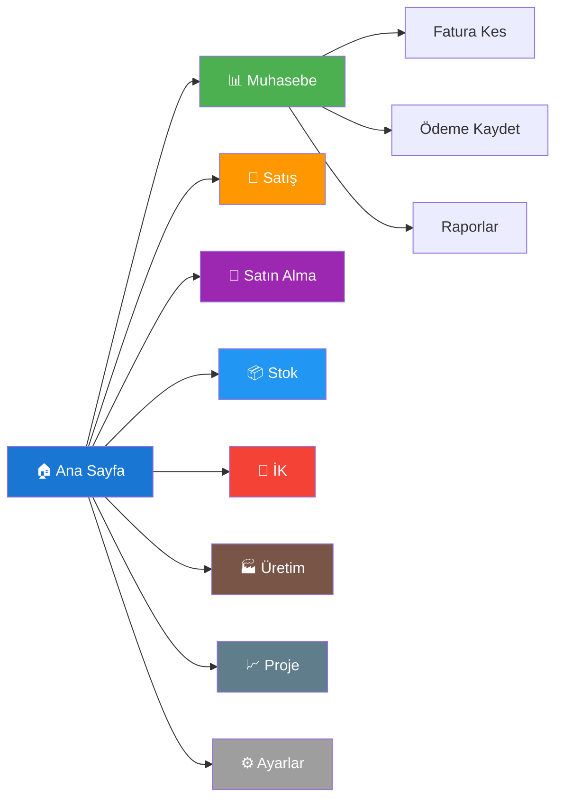
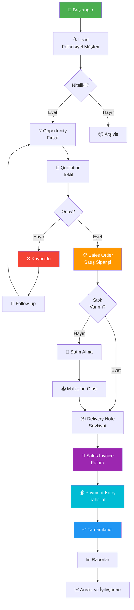
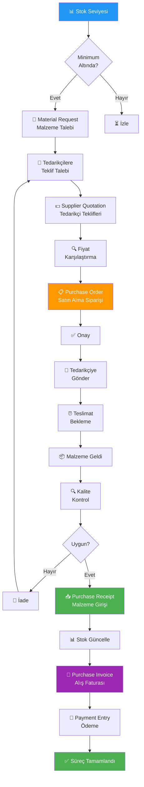
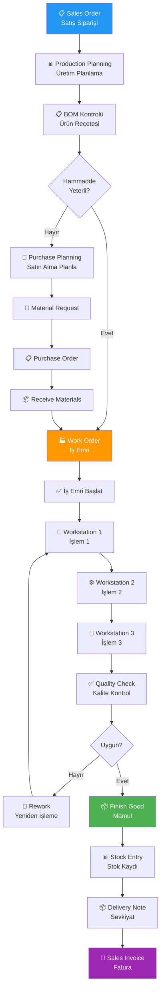

# ERPNext Görsel Rehber ve Ekran Görüntüleri

<p align="center">
  <strong>📸 Görsel Yardım ile ERPNext'i Keşfedin</strong>
</p>

---

## 📋 İçindekiler

- [Ana Ekran ve Dashboard](#ana-ekran-ve-dashboard)
- [Modül Navigasyonu](#modül-navigasyonu)
- [İş Akışı Diyagramları](#iş-akışı-diyagramları)
- [Form ve Belge Örnekleri](#form-ve-belge-örnekleri)
- [Rapor Ekranları](#rapor-ekranları)
- [Mobil Görünümler](#mobil-görünümler)

---

## 🖥️ Ana Ekran ve Dashboard

### Giriş Ekranı

<p align="center">
  
  <br/>
  <em>ERPNext giriş ekranı - Kullanıcı adı ve şifre ile giriş</em>
</p>

**Giriş Ekranı Özellikleri:**
- 🔐 Güvenli kimlik doğrulama
- 🌐 Çok dilli arayüz seçimi
- 🔑 Şifremi unuttum özelliği
- 📱 Mobil uyumlu tasarım

---

### Ana Dashboard

```
┌────────────────────────────────────────────────────────────────────────┐
│  🏠 ERPNext              [🔍 Hızlı Arama: Ctrl+K]    👤 Admin Kullanıcı │
├────────────────────────────────────────────────────────────────────────┤
│                                                                         │
│  📊 MODÜL KISA YOLLARı                                                 │
│  ┌──────────┬──────────┬──────────┬──────────┬──────────┬──────────┐  │
│  │ 💰       │ 💼       │ 🛒       │ 📦       │ 👥       │ 🏭       │  │
│  │ Muhasebe │ Satış    │ Satın A. │ Stok     │ İK       │ Üretim   │  │
│  │          │          │          │          │          │          │  │
│  │ 12 Açık  │ 8 Teklif │ 5 Sip.   │ 3 Uyarı  │ 2 İzin   │ 4 İş E.  │  │
│  └──────────┴──────────┴──────────┴──────────┴──────────┴──────────┘  │
│                                                                         │
│  📈 GÜNLÜK KPI KARTLARI                                                │
│  ┌─────────────────┬─────────────────┬─────────────────┬────────────┐ │
│  │ 💰 Günlük Satış │ 📦 Stok Durumu  │ 👥 Devam        │ ⏰ Görevler │ │
│  │                 │                 │                 │            │ │
│  │  ₺ 125.450      │    87%         │   45/48        │   12 Açık  │ │
│  │  ↗️ +15%        │    🟢 Normal    │   🟢 Tam       │   ⏳ 3 Acil│ │
│  └─────────────────┴─────────────────┴─────────────────┴────────────┘ │
│                                                                         │
│  📊 SATIŞ TRENDİ (Son 7 Gün)                                          │
│  ┌──────────────────────────────────────────────────────────────────┐ │
│  │                                                        *            │ │
│  │                                              *                     │ │
│  │                                    *                               │ │
│  │                          *                                         │ │
│  │                *                                                   │ │
│  │      *                                                             │ │
│  │                                                                    │ │
│  └──────────────────────────────────────────────────────────────────┘ │
│    Pzt    Sal    Çar    Per    Cum    Cmt    Paz                      │
│                                                                         │
│  📋 SON İŞLEMLER                      │  ⏰ YAKLASAN GÖREVLER          │
│  ┌────────────────────────────────────┼────────────────────────────┐  │
│  │ 📃 Satış Faturası #INV-2026-00123 │ ⏰ Bordro Hazırlama        │  │
│  │    ABC Teknoloji - 36.360 TL      │    Tarih: 25.11.2026       │  │
│  │    5 dakika önce                  │    Kalan: 6 gün            │  │
│  │                                    │                            │  │
│  │ 💰 Ödeme Girişi #PAY-2026-00089   │ 📦 Stok Sayımı            │  │
│  │    XYZ Ltd - 15.000 TL            │    Tarih: 30.11.2026       │  │
│  │    1 saat önce                    │    Kalan: 11 gün           │  │
│  │                                    │                            │  │
│  │ 📦 Stok Hareketi #STE-2026-00456  │ 📊 Aylık Raporlar         │  │
│  │    Transfer: Depo A → Depo B      │    Tarih: 01.12.2026       │  │
│  │    2 saat önce                    │    Kalan: 12 gün           │  │
│  └────────────────────────────────────┴────────────────────────────┘  │
│                                                                         │
│  [📄 Daha Fazla...]                   [✅ Tümünü Gör]                  │
└────────────────────────────────────────────────────────────────────────┘
```

<p align="center">
  
  <br/>
  <em>ERPNext ana dashboard - Tüm iş süreçlerinizin özeti tek ekranda</em>
</p>

---

## 🧭 Modül Navigasyonu

### Modül Geçiş Haritası



### Awesome Bar (Hızlı Arama)

<p align="center">
  
</p>

**Awesome Bar Kullanımı:**

```
┌─────────────────────────────────────────────────────────────┐
│  🔍 Ara (Ctrl+K): inv                                       │
├─────────────────────────────────────────────────────────────┤
│                                                              │
│  📃 Sales Invoice (Satış Faturası)                          │
│     Yeni fatura oluştur veya mevcut faturaları listele      │
│                                                              │
│  📋 Purchase Invoice (Alış Faturası)                        │
│     Tedarikçi faturası oluştur                              │
│                                                              │
│  💰 Invoice Discounting (Fatura İskontolama)                │
│     Fatura finansmanı                                        │
│                                                              │
│  SON ARAMALAR:                                              │
│  • INV-2026-00123                                           │
│  • INV-2026-00122                                           │
│  • INV-2026-00121                                           │
└─────────────────────────────────────────────────────────────┘
```

---

## 🔄 İş Akışı Diyagramları

### 1. Tam Satış Döngüsü



<p align="center">
  
</p>

---

### 2. Satın Alma ve Stok Akışı



---

### 3. Üretim Planlama Akışı



---

## 📝 Form ve Belge Örnekleri

### Satış Faturası Formu

<p align="center">
  
</p>

**Fatura Formu Anatomisi:**

```
┌─────────────────────────────────────────────────────────────────┐
│  📃 SATIŞ FATURASI                           [Taslak] [❌]      │
├─────────────────────────────────────────────────────────────────┤
│                                                                  │
│  Fatura No      : INV-2026-00123          Tarih: 19.11.2026    │
│  Müşteri        : ABC Teknoloji A.Ş.  [🔍] Vade : 30 gün       │
│  Vergi No       : 1234567890                   Vade Tarihi: ... │
│  Adres          : İstanbul, Türkiye                             │
│                                                                  │
├─────────────────────────────────────────────────────────────────┤
│  ÜRÜNLER                                                         │
│  ┌────┬────────────┬──────┬────────┬─────┬────────┬──────────┐ │
│  │ #  │ Ürün Kodu  │ Açık.│ Miktar │Birim│Fiyat   │Toplam    │ │
│  ├────┼────────────┼──────┼────────┼─────┼────────┼──────────┤ │
│  │ 1  │ LAPTOP-001 │Dell  │   2    │Adet │15.000  │30.000 TL │ │
│  │    │            │XPS 13│        │     │        │          │ │
│  ├────┼────────────┼──────┼────────┼─────┼────────┼──────────┤ │
│  │ 2  │ MOUSE-WL   │Kablos│   2    │Adet │  150   │  300 TL  │ │
│  │    │            │uz    │        │     │        │          │ │
│  └────┴────────────┴──────┴────────┴─────┴────────┴──────────┘ │
│                                                                  │
│  [+ Satır Ekle]                                                 │
│                                                                  │
├─────────────────────────────────────────────────────────────────┤
│  ÖZET                                                            │
│  ┌──────────────────────────────────────────────────┐          │
│  │  Ara Toplam                        30.300,00 TL  │          │
│  │  KDV %20                            6.060,00 TL  │          │
│  │  ─────────────────────────────────────────────── │          │
│  │  GENEL TOPLAM                      36.360,00 TL  │          │
│  └──────────────────────────────────────────────────┘          │
│                                                                  │
│  Ödeme Şartları: 30 gün vadeli                                 │
│  Not           : İyi günlerde kullanın                          │
│                                                                  │
├─────────────────────────────────────────────────────────────────┤
│  [💾 Kaydet]  [📤 Kaydet ve Gönder]  [🖨️ Yazdır]  [❌ İptal]   │
└─────────────────────────────────────────────────────────────────┘
```

---

### Ödeme Girişi Formu

<p align="center">
  
</p>

---

### Stok Hareketi Formu

<p align="center">
  
</p>

---

## 📊 Rapor Ekranları

### Mali Raporlar

#### Bilanço

<p align="center">
  
</p>

**Bilanço Örnek Görünüm:**

```
┌─────────────────────────────────────────────────────────────┐
│  📊 BİLANÇO                                                 │
│  Şirket: ABC Teknoloji A.Ş.                                 │
│  Dönem : 01.01.2026 - 30.11.2026                           │
├─────────────────────────────────────────────────────────────┤
│                                                              │
│  AKTİF (VARLIKLAR)                                          │
│  ├─ 💰 Dönen Varlıklar                    2.450.000 TL     │
│  │   ├─ Kasa                                  15.000 TL     │
│  │   ├─ Bankalar                             850.000 TL     │
│  │   ├─ Alıcılar                             925.000 TL     │
│  │   └─ Ticari Mallar                        660.000 TL     │
│  │                                                           │
│  ├─ 🏢 Duran Varlıklar                    1.200.000 TL     │
│  │   ├─ Tesisler, Makine                     900.000 TL     │
│  │   ├─ Taşıtlar                             400.000 TL     │
│  │   └─ Birikmiş Amortisman               (-100.000 TL)    │
│  │                                                           │
│  └─ TOPLAM AKTİF                          3.650.000 TL     │
│                                                              │
├─────────────────────────────────────────────────────────────┤
│                                                              │
│  PASİF (KAYNAKLAR)                                          │
│  ├─ 📋 Kısa Vadeli Borçlar                1.100.000 TL     │
│  │   ├─ Satıcılar                            650.000 TL     │
│  │   ├─ Ödenecek Vergiler                    180.000 TL     │
│  │   └─ Personel Borçları                    270.000 TL     │
│  │                                                           │
│  ├─ 💼 Özkaynaklar                        2.550.000 TL     │
│  │   ├─ Sermaye                            2.000.000 TL     │
│  │   ├─ Geçmiş Yıl Kârları                  300.000 TL     │
│  │   └─ Dönem Net Kârı                      250.000 TL     │
│  │                                                           │
│  └─ TOPLAM PASİF                          3.650.000 TL     │
│                                                              │
│  ✅ Denklik: Aktif = Pasif                                  │
└─────────────────────────────────────────────────────────────┘
```

---

#### Gelir Tablosu

<p align="center">
  
</p>

---

#### Nakit Akış Raporu

<p align="center">
  
</p>

---

### Operasyonel Raporlar

#### Stok Bakiye Raporu

<p align="center">
  
</p>

**Stok Bakiye Tablosu:**

| Ürün Kodu | Ürün Adı | Depo | Miktar | Birim | Birim Fiyat | Toplam Değer | Durum |
|-----------|----------|------|--------|-------|-------------|--------------|-------|
| LAPTOP-001 | Dell XPS 13 | Mamul | 15 | Adet | 15.000 TL | 225.000 TL | 🟢 Normal |
| MOUSE-WL | Kablosuz Fare | Mamul | 125 | Adet | 150 TL | 18.750 TL | 🟢 Normal |
| KB-MEC-01 | Mekanik Klavye | Mamul | 8 | Adet | 850 TL | 6.800 TL | 🟡 Düşük |
| MON-27-4K | 27" 4K Monitör | Mamul | 3 | Adet | 4.500 TL | 13.500 TL | 🔴 Kritik |

---

#### Satış Analizi

<p align="center">
  
</p>

**Grafik Türleri:**
- 📊 Çubuk grafik (Aylık satış karşılaştırma)
- 📈 Çizgi grafik (Satış trendi)
- 🥧 Pasta grafik (Ürün grubu dağılımı)
- 🎯 Heat map (Satış yoğunluğu)

---

## 📱 Mobil Görünümler

### Mobil Dashboard

<p align="center">
  
</p>

**Mobil Özellikler:**

```
┌─────────────────────┐
│  ERPNext         ☰  │
├─────────────────────┤
│                     │
│  📊 Bugün           │
│  ┌─────────────────┐│
│  │ Satış           ││
│  │ ₺ 125.450       ││
│  │ ↗️ +15%         ││
│  └─────────────────┘│
│                     │
│  📋 Bekleyen        │
│  • 5 Onay bekliyor  │
│  • 8 Teklif aşaması │
│  • 3 Stok uyarısı   │
│                     │
│  ⚡ Hızlı İşlem     │
│  [📝 Fatura Kes]    │
│  [💰 Ödeme Kaydet]  │
│  [📦 Stok Hareketı] │
│                     │
│  📱 Offline         │
│  ✅ Etkin           │
│                     │
└─────────────────────┘
```

---

### Mobil Fatura Formu

<p align="center">
  
</p>

---

### Mobil Devam Kaydı

<p align="center">
  
</p>

**Devam Kaydı - Tek Tıkla:**

```
┌─────────────────────┐
│  📅 Devam Kaydı     │
├─────────────────────┤
│                     │
│  📅 19.11.2026      │
│  🕐 14:52           │
│                     │
│  👤 Ahmet Yılmaz    │
│  💼 Satış Müdürü    │
│                     │
│  [✅ GELDİM]        │
│                     │
│  ─────────────────  │
│                     │
│  Bugünkü Durum      │
│  ✅ Sabah: 09:00    │
│  ⏸️ Öğle : 12:30    │
│  ✅ Öğle : 13:30    │
│  🏠 Akşam: --:--    │
│                     │
│  ⏱️ Toplam: 4:30    │
│                     │
└─────────────────────┘
```

---

## 🎨 Özelleştirme Örnekleri

### Özel Dashboard Tasarımı

<p align="center">
  
</p>

**Dashboard Bileşenleri:**
- 📊 KPI Kartları
- 📈 Trend Grafikleri
- 📋 To-Do Listesi
- 🔔 Bildirimler
- ⚡ Hızlı İşlem Butonları
- 📱 Widget'lar

---

### Özel Baskı Formatı

<p align="center">
  
</p>

**Baskı Format Öğeleri:**
- 🏢 Şirket logosu ve bilgileri
- 📋 QR kod (e-fatura için)
- 💧 Filigran
- 🎨 Özel renk şeması
- 📐 Profesyonel layout

---

## 🔍 Arama ve Filtreleme

### Gelişmiş Filtreler

<p align="center">
  
</p>

**Filtre Örnekleri:**

```
┌─────────────────────────────────────────────────┐
│  🔍 SATIŞ FATURALARI - FİLTRELER                │
├─────────────────────────────────────────────────┤
│                                                  │
│  📅 Tarih Aralığı                               │
│  [01.11.2026] → [30.11.2026]                   │
│                                                  │
│  👤 Müşteri                                     │
│  [Tüm Müşteriler ▼]                            │
│                                                  │
│  📊 Durum                                       │
│  ☑️ Taslak                                      │
│  ☑️ Gönderildi                                  │
│  ☐ İptal                                        │
│  ☐ Ödendi                                       │
│                                                  │
│  💰 Tutar                                       │
│  Min: [10.000]  Max: [100.000]                 │
│                                                  │
│  🏢 Şirket                                      │
│  [ABC Teknoloji ▼]                             │
│                                                  │
│  [🔍 Filtrele]  [🔄 Temizle]                   │
└─────────────────────────────────────────────────┘
```

---

## 📖 Sonuç

Bu görsel rehber, ERPNext'in temel özelliklerini ekran görüntüleri ve diyagramlarla açıklamaktadır. 

**Daha Fazla Bilgi:**
- 📚 [Ana Kullanım Kılavuzu](ERPNEXT_KULLANIM_KILAVUZU.md)
- ⚡ [Hızlı Başlangıç](ERPNEXT_HIZLI_BASLANGIC.md)
- 🌐 [Resmi Dokümantasyon](https://docs.erpnext.com)

---

**Not:** Bu rehberdeki ekran görüntüleri örnek amaçlıdır. Gerçek arayüz, ERPNext sürümüne ve özelleştirmelerinize göre değişiklik gösterebilir.

**Son Güncelleme:** Kasım 2026
**Versiyon:** ERPNext v15
