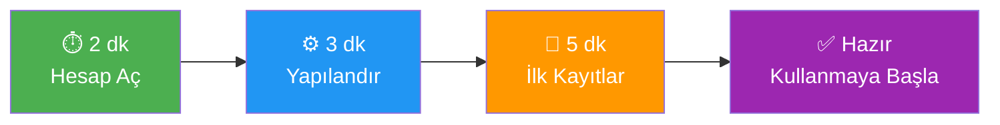
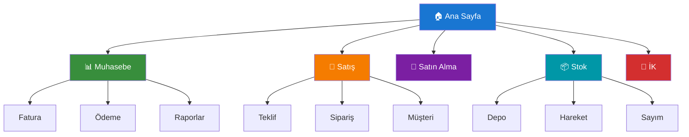

# ERPNext Hızlı Başlangıç Rehberi

<p align="center">
  
  <br/>
  <strong>10 Dakikada ERPNext'e Başlayın!</strong>
</p>

---

## 🎯 Hızlı Başlangıç Yol Haritası



---

## 🚀 Hemen Başlayın

### 1. Hesap Oluşturma (2 dakika)

**Bulut Sürümü (Önerilen):**
1. https://frappecloud.com adresine gidin
2. "Start Free Trial" → 14 gün ücretsiz deneme
3. Site adınızı belirleyin: `sirketiniz.frappe.cloud`
4. E-posta ile kayıt olun

**Yerel Kurulum:**
```bash
# Linux/Mac için tek komut kurulum
wget https://raw.githubusercontent.com/frappe/bench/develop/install.py
sudo python3 install.py --production --user myuser
```

### 2. İlk Yapılandırma (3 dakika)

Giriş yaptıktan sonra açılan sihirbazda:

```
✅ Ülke: Türkiye
✅ Dil: Türkçe
✅ Para Birimi: TRY
✅ Saat Dilimi: Asia/Istanbul

✅ Şirket Adı: ABC Teknoloji A.Ş.
✅ Mali Yıl: 01-01-2026 / 31-12-2026

✅ Sektör: İlgili sektörü seçin
✅ Modüller: İhtiyacınız olanları seçin
```

### 3. İlk Kayıtlar (5 dakika)

#### Müşteri Ekle
```
Satış > Müşteri > Yeni
→ Ad: Örnek Müşteri A.Ş.
→ Grup: Kurumsal
→ Kaydet
```

#### Ürün Ekle
```
Stok > Ürün > Yeni
→ Ürün Kodu: PRD-001
→ Ürün Adı: Laptop Dell XPS
→ Birim: Adet
→ Kaydet
```

#### İlk Fatura Kes
```
Muhasebe > Satış Faturası > Yeni
→ Müşteri seç
→ Ürün ekle
→ Miktar: 1
→ Fiyat: 25.000
→ KDV: %20
→ Kaydet ve Gönder
```

## 🖥️ ERPNext Dashboard Görünümü

**Ana Ekran - Modüller:**

```
┌────────────────────────────────────────────────────────────┐
│  🏠 ERPNext              [🔍 Ara: Ctrl+K]    👤 Admin  🔔  │
├────────────────────────────────────────────────────────────┤
│                                                             │
│  📊 Muhasebe    💼 Satış    🛒 Satın Alma   📦 Stok       │
│  👥 İK          🏭 Üretim   📈 Proje        ⚙️ Ayarlar    │
│                                                             │
│  ┌──────────────────────────────────────────────────────┐ │
│  │  📈 KPI Dashboard                                     │ │
│  │  ┌─────────────┬──────────────┬──────────────┐       │ │
│  │  │ 💰 Günlük   │ 📦 Stok      │ 👥 Personel  │       │ │
│  │  │ Satış       │ Durumu       │ Devam        │       │ │
│  │  │ 125.450 TL  │ %87          │ 45/48        │       │ │
│  │  └─────────────┴──────────────┴──────────────┘       │ │
│  └──────────────────────────────────────────────────────┘ │
│                                                             │
│  📋 Son İşlemler:                                          │
│  • Satış Faturası #INV-2026-00123                         │
│  • Ödeme Girişi #PAY-2026-00089                           │
│  • Stok Hareketi #STE-2026-00456                          │
│                                                             │
└────────────────────────────────────────────────────────────┘
```

**Modül Navigasyonu - Görsel Harita:**



## 📊 Günlük Kullanım Komutları

**Arayüz Navigasyonu:**

<p align="center">
  
</p>

### Hızlı Arama (AwesomeBar)
```
Ctrl + K → "Satış Faturası" yaz → Enter
```

**AwesomeBar Örnekleri:**

| Arama | Sonuç |
|-------|-------|
| `inv` | 📃 Sales Invoice (Satış Faturası) |
| `cust` | 👤 Customer (Müşteri) |
| `item` | 📦 Item (Ürün) |
| `pay` | 💰 Payment Entry (Ödeme) |
| `so` | 📋 Sales Order (Satış Siparişi) |

### Yeni Belge
```
Ctrl + G
```

### En Çok Kullanılan 10 İşlem

| # | İşlem | Kısayol |
|---|-------|---------|
| 1 | **Fatura Kes** | Muhasebe > Satış Faturası > Yeni |
| 2 | **Ödeme Kaydet** | Muhasebe > Ödeme Girişi > Yeni |
| 3 | **Sipariş Al** | Satış > Satış Siparişi > Yeni |
| 4 | **Stok Kontrol** | Stok > Raporlar > Stok Bakiyesi |
| 5 | **Teklif Hazırla** | Satış > Teklif > Yeni |
| 6 | **Alış Yap** | Satın Alma > Satın Alma Siparişi > Yeni |
| 7 | **Devam Kaydı** | İK > Devam > Yeni |
| 8 | **Görev Oluştur** | Proje > Görev > Yeni |
| 9 | **Rapor Al** | İlgili Modül > Raporlar |
| 10 | **Ayarlar** | Ayarlar > Sistem Ayarları |

## 🎯 İlk Hafta Hedefleri

**7 Günde ERPNext Uzmanı Olun:**

```mermaid
gantt
    title İlk Hafta Öğrenme Planı
    dateFormat  DD
    section Kurulum
    Şirket Bilgileri        :done, 01, 1d
    Kullanıcı & Rol         :done, 01, 1d
    section Temel Veri
    Müşteri & Tedarikçi     :active, 02, 1d
    Ürün Tanımlama          :active, 02, 1d
    section Stok
    Depo Yapısı             : 03, 1d
    Açılış Stoku            : 03, 1d
    section İşlemler
    İlk Fatura              : 04, 1d
    Satın Alma              : 05, 1d
    section Raporlar
    Rapor İnceleme          : 06, 2d
```



### 📅 Günlük Hedefler - Detaylı

**🗓️ Gün 1: Temel Kurulum**

```
┌─ Sabah (2 saat) ────────────────────────────────┐
│ ✅ Şirket bilgilerini tamamla                   │
│    • Logo yükle                                  │
│    • Adres ve iletişim bilgileri                │
│    • Vergi bilgileri                            │
│                                                  │
│ ✅ Kullanıcı rolleri ayarla                     │
│    • Muhasebeci, Satış, Depo rolleri           │
└──────────────────────────────────────────────────┘

┌─ Öğleden Sonra (2 saat) ────────────────────────┐
│ ✅ 3 müşteri ekle                                │
│ ✅ 5 ürün ekle (resim + fiyat ile)              │
│ ✅ 1 test faturası kes                           │
└──────────────────────────────────────────────────┘
```

**🗓️ Gün 2-3: Stok Yönetimi**

```
┌─ Depo Kurulumu ──────────────────────────────────┐
│ ✅ Depo yapısını oluştur                         │
│    📦 Ana Depo                                    │
│    ├─ 🔧 Hammadde                                │
│    ├─ ⚙️ Yarı Mamul                              │
│    └─ 📦 Mamul                                    │
│                                                   │
│ ✅ Açılış stoku gir (Excel'den yükle)            │
│ ✅ İlk stok hareketi yap (transfer)              │
│ ✅ Minimum stok seviyesi belirle                 │
└───────────────────────────────────────────────────┘
```

**🗓️ Gün 4-5: Satın Alma**

```
┌─ Tedarik Zinciri ────────────────────────────────┐
│ ✅ 3 tedarikçi ekle                              │
│    • İletişim bilgileri                          │
│    • Ödeme şartları                              │
│    • Banka bilgileri                             │
│                                                   │
│ ✅ İlk satın alma siparişi                       │
│    Talep → Teklif → Sipariş                     │
│                                                   │
│ ✅ Malzeme girişi yap                            │
│    • Kalite kontrol                              │
│    • Stok kaydı                                  │
└───────────────────────────────────────────────────┘
```

**🗓️ Gün 6-7: Raporlar & Analiz**

```
┌─ Raporlama Becerileri ───────────────────────────┐
│ ✅ Stok raporu al                                │
│    • Stok bakiyesi                               │
│    • Hareket raporu                              │
│    • Yaşlandırma                                 │
│                                                   │
│ ✅ Satış raporu incele                           │
│    • Müşteri bazlı                               │
│    • Ürün bazlı                                  │
│    • Trend analizi                               │
│                                                   │
│ ✅ Kâr-zarar raporu kontrol et                   │
│    • Gelir-gider analizi                         │
│    • Brüt kâr marjı                              │
└───────────────────────────────────────────────────┘
```

**İlerleme Takip Kartı:**

<table>
<tr>
<th>Gün</th>
<th>Konu</th>
<th>Hedef Süre</th>
<th>Durum</th>
<th>Notlar</th>
</tr>
<tr>
<td>1️⃣</td>
<td>Temel Kurulum</td>
<td>4 saat</td>
<td>⬜</td>
<td>_______________</td>
</tr>
<tr>
<td>2️⃣</td>
<td>Stok - Bölüm 1</td>
<td>3 saat</td>
<td>⬜</td>
<td>_______________</td>
</tr>
<tr>
<td>3️⃣</td>
<td>Stok - Bölüm 2</td>
<td>3 saat</td>
<td>⬜</td>
<td>_______________</td>
</tr>
<tr>
<td>4️⃣</td>
<td>Satın Alma - 1</td>
<td>3 saat</td>
<td>⬜</td>
<td>_______________</td>
</tr>
<tr>
<td>5️⃣</td>
<td>Satın Alma - 2</td>
<td>3 saat</td>
<td>⬜</td>
<td>_______________</td>
</tr>
<tr>
<td>6️⃣</td>
<td>Raporlar</td>
<td>3 saat</td>
<td>⬜</td>
<td>_______________</td>
</tr>
<tr>
<td>7️⃣</td>
<td>Genel Tekrar</td>
<td>2 saat</td>
<td>⬜</td>
<td>_______________</td>
</tr>
</table>

<p align="center">
  
</p>

## 💡 İpuçları

### Veri Girişi
```
📌 Excel'den toplu veri aktarımı için:
Araçlar > Veri İçe Aktar
```

### Yedekleme
```
⚠️ ÖNEMLİ: Günlük yedek alın!
Ayarlar > Sistem Ayarları > Yedekleme
→ Günlük otomatik yedek: ✅ Aktif
```

### Roller ve İzinler
```
👥 Kullanıcı eklerken doğru rol atayın:
- Muhasebeci → Accounts Manager
- Satış → Sales Manager
- Depo → Stock Manager
```

### Performans
```
⚡ Sistem yavaşlarsa:
1. Önbelleği temizle: Araçlar > Önbelleği Temizle
2. Eski kayıtları arşivle
3. Raporları filtreleyerek çalıştır
```

## 🆘 Acil Durum Çözümleri

### Şifremi Unuttum
```
Giriş ekranında "Şifremi Unuttum" → E-posta gelecek
```

### Yanlış Fatura Kestim
```
Faturayı aç → İptal Et butonu → Düzelt (Amend)
```

### Negatif Stok Hatası
```
Ayarlar > Stok Ayarları
→ "Negatif Stoğa İzin Ver" ✅
```

### Yetki Hatası
```
Ayarlar > Kullanıcılar > [Kullanıcı]
→ Rolleri kontrol et ve ekle
```

## 📱 Mobil Kullanım

### iOS
```
App Store > "ERPNext" ara > İndir
→ Site URL'i gir
→ Kullanıcı adı ve şifre ile giriş
```

### Android
```
Play Store > "ERPNext" ara > İndir
→ Site URL'i gir
→ Kullanıcı adı ve şifre ile giriş
```

### Mobilde En Çok Kullanılanlar
- ✅ Devam kaydı
- ✅ Onay bekleyen belgeler
- ✅ Hızlı fatura kesme
- ✅ Raporları görüntüleme

## 🎓 Öğrenme Kaynakları

### Video Eğitimler
```
YouTube'da arayın:
→ "ERPNext Tutorial Türkçe"
→ "ERPNext Muhasebe"
→ "ERPNext Stok Yönetimi"
```

### Dokümantasyon
```
📚 Resmi Dokümantasyon:
https://docs.erpnext.com

🇹🇷 Türkçe Topluluk Forum:
https://discuss.erpnext.com
```

### Pratik Yapma
```
💪 Test sitesi oluşturun:
→ Gerçek verilerinizi kullanmadan
→ Tüm işlemleri deneyin
→ Hata yapın ve öğrenin!
```

## 🔥 İlk 24 Saatte Yapılması Gerekenler

### Öncelik 1 (Mutlaka)
- [x] Şirket bilgilerini tamamla
- [x] Hesap planını kontrol et
- [x] Otomatik yedeklemeyi aç
- [x] E-posta ayarlarını yap
- [x] Logo yükle

### Öncelik 2 (Önerilen)
- [ ] Baskı formatlarını özelleştir
- [ ] Kullanıcı rollerini belirle
- [ ] Temel ürünleri ekle
- [ ] Müşterileri aktar
- [ ] İlk stok sayımını yap

### Öncelik 3 (İlerisi için)
- [ ] Özel alanlar ekle
- [ ] İş akışları oluştur
- [ ] Raporları özelleştir
- [ ] Entegrasyonları kur
- [ ] Topluluğa katıl

## 📞 Destek

### Ücretsiz Kaynaklar
- **Forum:** https://discuss.erpnext.com
- **GitHub:** https://github.com/frappe/erpnext
- **Telegram:** ERPNext Türkiye grubu

### Ücretli Destek
- **Frappe Cloud:** support@frappe.cloud
- **Danışmanlık:** Forum'da firma listesi

## ✅ Kontrol Listesi

İlk haftanın sonunda şunları yapabilmelisiniz:

- [ ] Fatura kesebiliyorum
- [ ] Ödeme kaydı yapabiliyorum
- [ ] Stok hareketi girebiliyorum
- [ ] Temel raporları alabiliyorum
- [ ] Kullanıcı ekleyebiliyorum
- [ ] Yedek alabiliyorum

Hepsi tamam mı? 🎉 Tebrikler! ERPNext kullanmaya hazırsınız!

---

**Daha Detaylı Bilgi:** `ERPNEXT_KULLANIM_KILAVUZU.md` dosyasına bakın.

**Sürüm:** ERPNext v15 | **Güncelleme:** Kasım 2026
