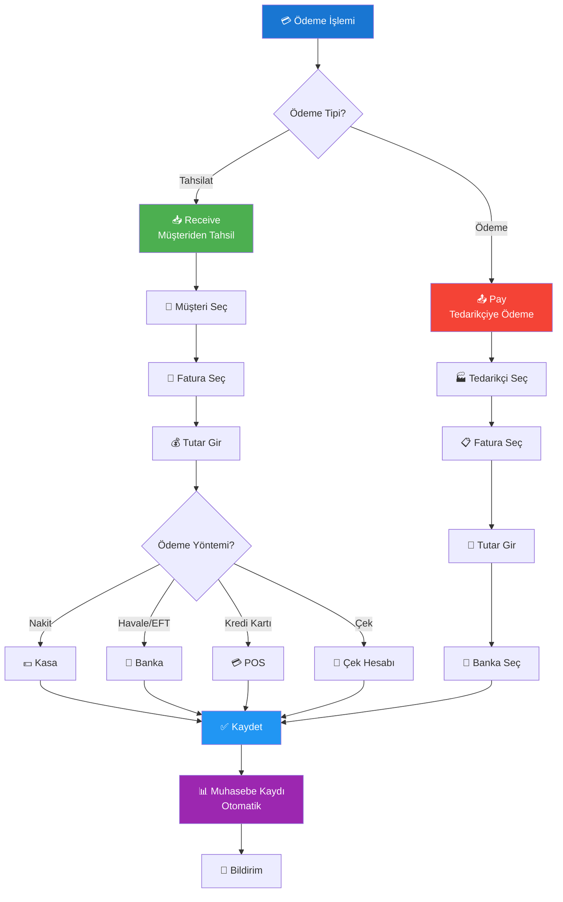
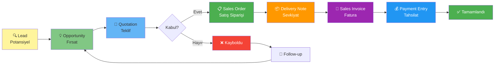
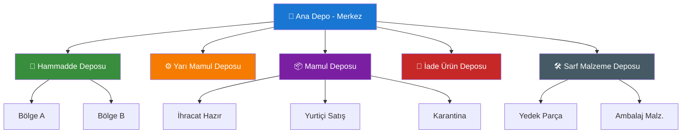
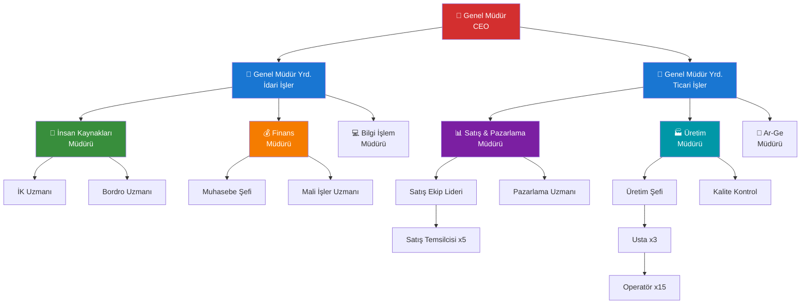
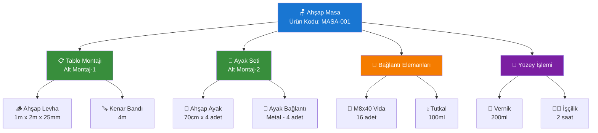

<!-- ERPNext Türkçe Kullanım Kılavuzu -->

# ERPNext Kullanım Kılavuzu

<p align="center">
  
</p>

<p align="center">
  <strong>Açık Kaynaklı Kurumsal Kaynak Planlama (ERP) Sistemi</strong>
  <br />
  Kapsamlı Türkçe Kullanım Kılavuzu
</p>

---

## İçindekiler

- [ERPNext Nedir?](#erpnext-nedir)
- [Başlangıç](#başlangıç)
  - [Sistem Gereksinimleri](#sistem-gereksinimleri)
  - [Kurulum](#kurulum)
  - [İlk Giriş ve Yapılandırma](#ilk-giriş-ve-yapılandırma)
- [Ana Modüller](#ana-modüller)
  - [Muhasebe (Accounting)](#1-muhasebe-accounting)
  - [Satın Alma (Buying)](#2-satın-alma-buying)
  - [Satış (Selling)](#3-satış-selling)
  - [Stok Yönetimi (Stock)](#4-stok-yönetimi-stock)
  - [İnsan Kaynakları (HR)](#5-insan-kaynakları-hr)
  - [Üretim (Manufacturing)](#6-üretim-manufacturing)
  - [Proje Yönetimi (Projects)](#7-proje-yönetimi-projects)
  - [CRM (Müşteri İlişkileri)](#8-crm-müşteri-i̇lişkileri)
- [Günlük İşlemler](#günlük-i̇şlemler)
- [Raporlar ve Analizler](#raporlar-ve-analizler)
- [Özelleştirme](#özelleştirme)
- [Yedekleme ve Güvenlik](#yedekleme-ve-güvenlik)
- [Sık Sorulan Sorular](#sık-sorulan-sorular)
- [Destek ve Kaynaklar](#destek-ve-kaynaklar)

---

## ERPNext Nedir?

<p align="center">
  
  <br/>
  <em>ERPNext - Tüm İş Süreçlerinizi Tek Platformda Yönetin</em>
</p>

ERPNext, Frappe Framework üzerine kurulmuş, **tamamen açık kaynaklı** ve **ücretsiz** bir kurumsal kaynak planlama (ERP) sistemidir. Küçük ve orta ölçekli işletmeler (KOBİ'ler) için tasarlanmış olup, aşağıdaki özellikleri sunar:

- ✅ **Tam Entegre Sistem**: Muhasebe, stok, satış, satın alma, üretim, İK ve daha fazlası
- ✅ **Web Tabanlı**: Her yerden erişim, kurulum gerektirmez
- ✅ **Açık Kaynak**: Kodu inceleyebilir, özelleştirebilirsiniz
- ✅ **Çok Dilli**: Türkçe dahil 90+ dil desteği
- ✅ **Mobil Uyumlu**: Tablet ve akıllı telefondan kullanım
- ✅ **Topluluk Desteği**: Geniş kullanıcı ve geliştirici topluluğu

### ERPNext Modül Mimarisi

```mermaid
graph TB
    A[ERPNext Ana Sistem] --> B[Muhasebe]
    A --> C[Satış & CRM]
    A --> D[Satın Alma]
    A --> E[Stok Yönetimi]
    A --> F[İnsan Kaynakları]
    A --> G[Üretim]
    A --> H[Proje Yönetimi]
    
    B --> B1[Faturalar]
    B --> B2[Ödemeler]
    B --> B3[Mali Raporlar]
    
    C --> C1[Teklifler]
    C --> C2[Siparişler]
    C --> C3[Müşteri Yönetimi]
    
    D --> D1[Satın Alma Siparişi]
    D --> D2[Tedarikçi Yönetimi]
    D --> D3[Malzeme Talepleri]
    
    E --> E1[Depo Yönetimi]
    E --> E2[Stok Hareketi]
    E --> E3[Seri No/Parti Takibi]
    
    F --> F1[Çalışan Yönetimi]
    F --> F2[Bordro]
    F --> F3[İzin & Devam]
    
    G --> G1[Ürün Reçetesi BOM]
    G --> G2[İş Emirleri]
    G --> G3[Kapasite Planlama]
    
    H --> H1[Görevler]
    H --> H2[Zaman Takibi]
    H --> H3[Gantt Şemaları]
    
    style A fill:#1f77b4,color:#fff
    style B fill:#2ca02c,color:#fff
    style C fill:#ff7f0e,color:#fff
    style D fill:#d62728,color:#fff
    style E fill:#9467bd,color:#fff
    style F fill:#8c564b,color:#fff
    style G fill:#e377c2,color:#fff
    style H fill:#7f7f7f,color:#fff
```



### ERPNext ile Neler Yapabilirsiniz?

<table>
<tr>
<td width="50%">

**📊 Finansal Yönetim**
- Fatura kesme ve muhasebe takibi
- Banka mutabakatı
- Vergi hesaplamaları
- Mali raporlar ve analizler

**🛒 Satın Alma & Tedarik**
- Tedarikçi yönetimi
- Satın alma siparişleri
- Malzeme talepleri
- Fiyat karşılaştırma

</td>
<td width="50%">

**💼 Satış & Müşteri**
- CRM ve fırsat takibi
- Teklif hazırlama
- Satış siparişleri
- Sevkiyat yönetimi

**📦 Stok & Lojistik**
- Çoklu depo yönetimi
- Seri no/parti takibi
- Stok transfer ve sayım
- Minimum stok uyarıları

</td>
</tr>
<tr>
<td>

**👥 İnsan Kaynakları**
- Personel yönetimi
- Bordro ve maaş hesaplama
- İzin ve devam takibi
- Performans değerlendirme

**🏭 Üretim Planlama**
- Ürün reçetesi (BOM)
- İş emirleri
- Üretim planlama
- Kapasite yönetimi

</td>
<td>

**📈 Proje & Görev**
- Proje yönetimi
- Görev takibi
- Zaman çizelgeleri
- Gantt şemaları

**🔍 Raporlama & BI**
- Gerçek zamanlı dashboardlar
- Özelleştirilebilir raporlar
- KPI takibi
- Veri analizi

</td>
</tr>
</table>

---

## Başlangıç

### Sistem Gereksinimleri

#### Bulut Çözümü (Önerilen Başlangıç)
- **Frappe Cloud**: https://frappecloud.com
- Kurulum gerektirmez, hemen kullanıma hazır
- Aylık abonelik: $10-$50 arası (kullanıma göre)

#### Kendi Sunucunuzda Kurulum
- **İşletim Sistemi**: Ubuntu 20.04 LTS / 22.04 LTS (önerilen)
- **RAM**: Minimum 4GB (8GB önerilen)
- **Disk**: 40GB+ SSD
- **CPU**: 2+ core
- **Yazılım**: Python 3.10+, Node.js 18+, MariaDB 10.6+

### Kurulum

#### A) Frappe Cloud ile Hızlı Başlangıç (5 dakika)

1. https://frappecloud.com adresine gidin
2. "Start Free Trial" butonuna tıklayın
3. E-posta ile kayıt olun
4. Site adınızı seçin (örn: sirketim.frappe.cloud)
5. ERPNext seçin ve "Deploy" butonuna basın

#### B) Kendi Sunucunuzda Kurulum (Linux)

```bash
# 1. Sistem güncellemesi
sudo apt update && sudo apt upgrade -y

# 2. Bench kurulumu (ERPNext kurulum aracı)
sudo apt install python3-pip python3-dev python3-setuptools python3-venv -y
sudo pip3 install frappe-bench

# 3. Yeni bir bench oluştur
bench init frappe-bench --frappe-branch version-15
cd frappe-bench

# 4. ERPNext'i indir
bench get-app erpnext --branch version-15

# 5. Yeni site oluştur
bench new-site sirketim.local
bench --site sirketim.local install-app erpnext

# 6. Geliştirme sunucusunu başlat
bench start
```

#### C) Docker ile Kurulum

```bash
# Docker Compose ile
git clone https://github.com/frappe/frappe_docker.git
cd frappe_docker
docker-compose up -d
```

### İlk Giriş ve Yapılandırma

#### 1. İlk Giriş

- URL: `http://sizin-site-adresiniz:8000` veya bulut adresi
- Varsayılan kullanıcı: `Administrator`
- Şifre: Kurulum sırasında belirlediğiniz şifre

#### 2. Kurulum Sihirbazı (Setup Wizard)

İlk girişte size şu bilgiler sorulacak:

**Temel Bilgiler:**
- Ülke: **Türkiye**
- Dil: **Türkçe**
- Para Birimi: **TRY (Türk Lirası)**
- Saat Dilimi: **Asia/Istanbul**

**Şirket Bilgileri:**
- Şirket adı (örn: ABC Teknoloji A.Ş.)
- Şirket kısaltması (örn: ABC)
- Mali yıl başlangıcı
- Sektör (İmalat, Hizmet, Perakende vb.)

**Modül Seçimi:**
- İhtiyacınız olan modülleri seçin (sonradan değiştirilebilir)

**Örnek Veri:**
- Başlangıç için "Örnek Veri Yükle" seçeneğini işaretleyin (öğrenme amaçlı)

---

## Ana Modüller

### 1. Muhasebe (Accounting)

ERPNext'in muhasebe modülü, Türkiye'deki vergi mevzuatına uyumlu çalışabilir.

#### 1.1 Hesap Planı (Chart of Accounts)

**Erişim:** `Muhasebe > Hesap Planı`

**Türkiye Tek Düzen Hesap Planı (TDHP) - Görsel Ağaç:**

```mermaid
graph TD
    ROOT[🏦 Hesap Planı] --> A[💰 100 Dönen Varlıklar]
    ROOT --> B[🏢 200 Duran Varlıklar]
    ROOT --> C[📋 300 KVYK]
    ROOT --> D[📊 400 UVYK]
    ROOT --> E[💼 500 Özkaynaklar]
    ROOT --> F[📈 600 Gelirler]
    ROOT --> G[📉 700 Giderler]
    
    A --> A1[100 Kasa]
    A --> A2[102 Bankalar]
    A --> A3[120 Alıcılar]
    A --> A4[153 Ticari Mallar]
    
    A2 --> A21[102.01 Ziraat Bankası]
    A2 --> A22[102.02 İş Bankası]
    A2 --> A23[102.03 Garanti BBVA]
    
    C --> C1[320 Satıcılar]
    C --> C2[360 Ödenecek Vergiler]
    C --> C3[335 Personele Borçlar]
    
    C2 --> C21[360.01 KDV]
    C2 --> C22[360.02 Gelir Vergisi]
    C2 --> C23[360.03 Damga Vergisi]
    
    F --> F1[600 Yurtiçi Satışlar]
    F --> F2[601 Yurtdışı Satışlar]
    F --> F3[602 Hizmet Satışları]
    
    G --> G1[750 Pazarlama Giderleri]
    G --> G2[770 Genel Yönetim]
    G --> G3[780 Finansman Giderleri]
    
    style ROOT fill:#1976d2,color:#fff
    style A fill:#4caf50,color:#fff
    style B fill:#2196f3,color:#fff
    style C fill:#f44336,color:#fff
    style D fill:#9c27b0,color:#fff
    style E fill:#009688,color:#fff
    style F fill:#8bc34a,color:#fff
    style G fill:#ff5722,color:#fff
```



**TDHP Hiyerarşik Yapı:**

```
📊 ANA HESAPLAR (Türkiye - TDHP Uyumlu)
│
├── 💰 100-199 DÖNEN VARLIKLAR
│   ├── 100 Kasa
│   │   ├── 100.01 TL Kasa
│   │   └── 100.02 Döviz Kasa (USD)
│   ├── 102 Bankalar
│   │   ├── 102.01 Ziraat Bankası - TL Vadesiz
│   │   ├── 102.02 İş Bankası - TL Vadeli
│   │   └── 102.03 Garanti BBVA - Döviz
│   ├── 108 Diğer Hazır Değerler
│   ├── 120 Alıcılar
│   │   ├── 120.01 Yurtiçi Alıcılar
│   │   └── 120.02 Yurtdışı Alıcılar
│   ├── 121 Alacak Senetleri
│   └── 153 Ticari Mallar
│
├── 🏢 200-299 DURAN VARLIKLAR
│   ├── 253 Tesisler, Makine ve Cihazlar
│   ├── 254 Taşıtlar
│   └── 257 Birikmiş Amortismanlar (-)
│
├── 📋 300-399 KISA VADELİ YABANCI KAYNAKLAR
│   ├── 320 Satıcılar
│   │   ├── 320.01 Yurtiçi Satıcılar
│   │   └── 320.02 Yurtdışı Satıcılar
│   ├── 335 Personele Borçlar
│   ├── 360 Ödenecek Vergi ve Fonlar
│   │   ├── 360.01 Ödenecek KDV
│   │   ├── 360.02 Ödenecek Gelir Vergisi
│   │   ├── 360.03 Ödenecek Damga Vergisi
│   │   └── 360.04 Ödenecek SGK Primi
│   └── 361 Ödenecek Sosyal Güvenlik Kesintileri
│
├── 📊 400-499 UZUN VADELİ YABANCI KAYNAKLAR
│   └── 400 Banka Kredileri
│
├── 💼 500-599 ÖZKAYNAKLAR
│   ├── 500 Sermaye
│   ├── 540 Geçmiş Yıllar Kârları
│   └── 590 Dönem Net Kârı/Zararı
│
├── 📈 600-699 GELİRLER
│   ├── 600 Yurtiçi Satışlar
│   ├── 601 Yurtdışı Satışlar
│   ├── 602 Hizmet Satışları
│   ├── 610 Satıştan İadeler (-)
│   ├── 611 Satış İskontoları (-)
│   └── 691 Kur Farkı Gelirleri
│
└── 📉 700-799 GİDERLER
    ├── 710 Direkt İlk Madde ve Malzeme Giderleri
    ├── 720 Direkt İşçilik Giderleri
    ├── 730 Genel Üretim Giderleri
    ├── 750 Araştırma ve Geliştirme Giderleri
    ├── 760 Pazarlama, Satış ve Dağıtım Giderleri
    ├── 770 Genel Yönetim Giderleri
    │   ├── 770.01 Personel Ücretleri
    │   ├── 770.02 SGK İşveren Payı
    │   ├── 770.03 Kira Giderleri
    │   ├── 770.04 Elektrik-Su-Doğalgaz
    │   └── 770.05 Haberleşme Giderleri
    └── 780 Finansman Giderleri
        └── 780.01 Kredi Faiz Giderleri
```

<p align="center">
  
</p>

**Yeni Hesap Ekleme:**
1. Muhasebe > Hesap Planı'na git
2. İlgili ana grubun üzerine tıkla
3. "Yeni Alt Hesap Ekle" butonuna bas
4. Hesap kodu ve adını gir

#### 1.2 Fatura İşlemleri

**Satış Faturası (Sales Invoice):**

```
Muhasebe > Satış Faturası > Yeni
```

**Zorunlu Alanlar:**
- Müşteri adı
- Tarih ve vade
- Ürün/hizmet detayları
- KDV oranı (%1, %10, %20)
- Toplam tutar

**Fatura Örneği:**

| Ürün | Miktar | Birim Fiyat | KDV % | Ara Toplam |
|------|--------|-------------|-------|------------|
| Laptop X200 | 2 | 15.000 TL | 20% | 30.000 TL |
| Fare Kablosuz | 2 | 150 TL | 20% | 300 TL |
| **Ara Toplam** | | | | **30.300 TL** |
| **KDV (20%)** | | | | **6.060 TL** |
| **GENEL TOPLAM** | | | | **36.360 TL** |

**Alış Faturası (Purchase Invoice):**

```
Muhasebe > Alış Faturası > Yeni
```

Satıcıdan aldığınız malzeme/hizmet faturaları için kullanılır.

#### 1.3 Ödeme Girişi (Payment Entry)

**Ödeme Süreci - Görsel Akış:**



**Tahsilat İşlemi - Adım Adım:**

<table>
<tr>
<th>Adım</th>
<th>İşlem</th>
<th>Ekran</th>
<th>Notlar</th>
</tr>
<tr>
<td>1️⃣</td>
<td>Ödeme Girişi Aç</td>
<td><code>Muhasebe > Ödeme Girişi > Yeni</code></td>
<td>Yeni kayıt başlat</td>
</tr>
<tr>
<td>2️⃣</td>
<td>Ödeme Tipi</td>
<td><strong>Receive (Tahsil)</strong></td>
<td>Müşteriden para alıyoruz</td>
</tr>
<tr>
<td>3️⃣</td>
<td>Parti Tipi</td>
<td><strong>Customer (Müşteri)</strong></td>
<td>Müşteri seç butonu aktif olur</td>
</tr>
<tr>
<td>4️⃣</td>
<td>Müşteri</td>
<td>Listeden müşteri seç</td>
<td>Açık faturaları gelir</td>
</tr>
<tr>
<td>5️⃣</td>
<td>Ödeme Hesabı</td>
<td><strong>Kasa</strong> veya <strong>Banka</strong></td>
<td>Para nereye giriyor</td>
</tr>
<tr>
<td>6️⃣</td>
<td>Tutar</td>
<td>Tahsil edilen miktarı gir</td>
<td>Fatura tutarına eşit veya kısmi</td>
</tr>
<tr>
<td>7️⃣</td>
<td>Fatura Eşleştirme</td>
<td>Faturayı seç ve eşleştir</td>
<td>Otomatik açık bakiye gösterir</td>
</tr>
<tr>
<td>8️⃣</td>
<td>Kaydet</td>
<td><strong>Save and Submit</strong></td>
<td>Muhasebe kaydı otomatik</td>
</tr>
</table>

**Ödeme Yöntemleri Karşılaştırma:**

| Yöntem | Hesap | Avantaj | Dezavantaj | Takip |
|--------|-------|---------|------------|-------|
| 💵 **Nakit** | Kasa | Anında | Risk | Günlük sayım |
| 🏦 **Havale/EFT** | Banka | Güvenli | 1-2 gün | Mutabakat |
| 💳 **Kredi Kartı** | POS | Hızlı | Komisyon | Banka özeti |
| 📝 **Çek** | Çek Hesabı | Vadeli | Risk | Tahsilat takip |

**Tahsilat Kaydı Örneği:**

```
┌─────────────────────────────────────────────────┐
│  📥 ÖDEME GİRİŞİ - TAHSİLAT                     │
├─────────────────────────────────────────────────┤
│  Ödeme Tipi      : 📥 Receive (Tahsilat)       │
│  Parti Tipi      : 👤 Customer                  │
│  Müşteri         : ABC Teknoloji A.Ş.          │
│  Tarih           : 19.11.2026                   │
│  ─────────────────────────────────────────────  │
│  Ödeme Hesabı    : 🏦 102.01 Ziraat Bankası    │
│  Tutar           : 36.360,00 TL                 │
│  ─────────────────────────────────────────────  │
│  Fatura          : INV-2026-00123               │
│  Fatura Tutarı   : 36.360,00 TL                 │
│  Önceki Ödeme    : 0,00 TL                      │
│  Bu Ödeme        : 36.360,00 TL                 │
│  Kalan           : 0,00 TL                      │
│  ─────────────────────────────────────────────  │
│  Referans No     : HAVALE-123456                │
│  Not             : Fatura bedelinin tamamı      │
│  ─────────────────────────────────────────────  │
│  [💾 Kaydet]  [📤 Kaydet ve Gönder]  [❌ İptal] │
└─────────────────────────────────────────────────┘
```

**Otomatik Muhasebe Kaydı:**

| Borç | Alacak | Hesap | Tutar |
|------|--------|-------|-------|
| ✅ | | 102.01 Ziraat Bankası | 36.360,00 TL |
| | ✅ | 120.01 Alıcılar - ABC Teknoloji | 36.360,00 TL |

<p align="center">
  
</p>

**Tedarikçiye Ödeme Kaydı:**
```
Ödeme Tipi: 📤 Pay (Ödeme)
Parti Tipi: 🏭 Supplier (Tedarikçi)
Satıcıyı seç → Fatura seç → Tutar → Banka → Kaydet
```

#### 1.4 Banka Mutabakatı

**Banka İşlemleri Mutabakatı:**

```
Muhasebe > Banka Mutabakatı > Yeni
```

1. Banka hesabını seç
2. Excel'den banka ekstresini yükle
3. Otomatik eşleştir
4. Manuel kontrol yap
5. Mutabakat tamamla

#### 1.5 Mali Raporlar

**Bilanço:**
```
Muhasebe > Raporlar > Bilanço
```

**Gelir Tablosu:**
```
Muhasebe > Raporlar > Kâr Zarar Raporu
```

**Nakit Akış Tablosu:**
```
Muhasebe > Raporlar > Nakit Akış Raporu
```

**Yaşlandırma Raporu (Alacaklar/Borçlar):**
```
Muhasebe > Raporlar > Alacak Yaşlandırma Raporu
```

---

### 2. Satın Alma (Buying)

#### 2.1 Satıcı Tanımlama

```
Satın Alma > Satıcı > Yeni
```

**Gerekli Bilgiler:**
- Satıcı adı
- Vergi numarası/kimlik
- İletişim bilgileri
- Ödeme şartları (vade gün sayısı)
- Banka bilgileri

#### 2.2 Satın Alma Süreci

**Görsel İş Akışı:**


**Detaylı Akış Şeması:**

<p align="center">
  
</p>

**Tam Süreç:**
```
1. Malzeme Talebi → 2. Tedarikçi Teklifi → 3. Satın Alma Siparişi → 
4. Malzeme Girişi → 5. Alış Faturası → 6. Ödeme
```

**1. Malzeme Talebi (Material Request):**

```
Satın Alma > Malzeme Talebi > Yeni
```

- Talep eden departman
- İhtiyaç tarihi
- Ürün listesi ve miktarları

**2. Tedarikçi Teklifi (Supplier Quotation):**

```
Satın Alma > Tedarikçi Teklifi > Yeni
```

- Birden fazla tedarikçiden teklif alın
- Fiyat karşılaştırması yapın

**3. Satın Alma Siparişi (Purchase Order):**

```
Satın Alma > Satın Alma Siparişi > Yeni
```

- Onaylanan tedarikçiyi seç
- Teslim tarihini belirle
- Sipariş detaylarını gir
- Onaya gönder

**4. Malzeme Girişi (Purchase Receipt):**

```
Stok > Malzeme Girişi > Yeni
```

- Satın alma siparişinden çek
- Teslim alınan miktarı kontrol et
- Depo seç
- Kaydet (stok otomatik artar)

#### 2.3 Satıcı Değerlendirme

```
Satın Alma > Satıcı Değerlendirme
```

Kriterlere göre satıcı performansını değerlendirin:
- Teslimat süresi
- Kalite
- Fiyat
- İletişim

---

### 3. Satış (Selling)

#### 3.1 Müşteri Tanımlama

```
Satış > Müşteri > Yeni
```

**Müşteri Grupları:**
- Bireysel (B2C)
- Kurumsal (B2B)
- Distribütör
- Bayi

**Önemli Alanlar:**
- Müşteri adı ve tipi
- Vergi dairesi ve numarası
- Fatura ve sevk adresleri
- Kredi limiti
- Ödeme şartları

#### 3.2 Satış Süreci

**Görsel İş Akışı:**



**CRM'den Tahsilata Tam Süreç:**

<p align="center">
  
</p>

**Aşama Bazlı Detaylar:**

| Aşama | Durum | Sorumlu | Ortalama Süre |
|-------|-------|---------|---------------|
| 🔍 **Lead** | Yeni İlgi | Satış | 1-2 gün |
| 💡 **Opportunity** | Görüşmeler | Satış | 3-7 gün |
| 📄 **Quotation** | Teklif Sunuldu | Satış | 1-3 gün |
| 📋 **Sales Order** | Onaylandı | Satış/Ops | Anında |
| 📦 **Delivery** | Sevk Hazırlık | Lojistik | 1-5 gün |
| 📃 **Invoice** | Fatura Kesildi | Muhasebe | Anında |
| 💰 **Payment** | Tahsilat | Muhasebe | Vade gününde |

**Süreç Yönetimi İpuçları:**

```
✅ Her aşamayı takip edin
✅ Müşteriyi sürekli bilgilendirin  
✅ Belgeleri birbirine bağlayın (link)
✅ Ödeme şartlarını net belirtin
✅ Teslimat tarihlerini takip edin
```

**1. Potansiyel Müşteri (Lead):**

```
CRM > Potansiyel Müşteri > Yeni
```

- İletişim bilgileri
- İlgi alanı
- Kaynak (web sitesi, referans vb.)

**2. Fırsat (Opportunity):**

```
CRM > Fırsat > Yeni
```

- Potansiyel gelir
- Kapanış olasılığı
- Beklenen kapanış tarihi

**3. Teklif (Quotation):**

```
Satış > Teklif > Yeni
```

**Teklif Hazırlama:**
- Müşteri seç
- Ürün/hizmetleri ekle
- İskonto uygula (gerekirse)
- Teslim şartları
- Geçerlilik süresi
- PDF olarak indir/e-posta gönder

**4. Satış Siparişi (Sales Order):**

```
Satış > Satış Siparişi > Yeni
```

Teklif kabul edildiğinde siparişe çevirin:
- Teslim tarihi
- Ödeme şartları
- Özel notlar

**5. Sevkiyat Notu (Delivery Note):**

```
Stok > Sevkiyat Notu > Yeni
```

- Satış siparişinden çek
- Sevk edilecek ürünleri işaretle
- Kargo bilgileri
- Kaydet (stok otomatik azalır)

**6. Satış Faturası:**

Sevkiyat notundan veya satış siparişinden fatura oluştur.

#### 3.3 Fiyat Listeleri

```
Satış > Fiyat Listesi > Yeni
```

Farklı müşteri grupları için farklı fiyatlar:
- Perakende Fiyat Listesi
- Toptan Fiyat Listesi
- Bayi Fiyat Listesi

---

### 4. Stok Yönetimi (Stock)

#### 4.1 Depo Yapısı

```
Stok > Depo > Depo Ağacı
```

**Hiyerarşik Depo Organizasyonu:**



**Örnek Depo Yapısı - Detaylı:**

<p align="center">
  
</p>

**Depo Tipleri ve Kullanım Alanları:**

| Depo Tipi | Kullanım | Stok Takibi | Özellikler |
|-----------|----------|-------------|------------|
| 🔧 **Hammadde** | Üretim girdileri | FIFO/LIFO | Lot bazlı |
| ⚙️ **Yarı Mamul** | Üretim ara ürün | Parti No | WIP takibi |
| 📦 **Mamul** | Satışa hazır | Seri No | Kalite onaylı |
| 🔄 **İade** | Geri dönen ürün | Seri No | Karantina |
| 🛠️ **Sarf** | Yardımcı malzeme | Basit | Tüketim |

**ASCII Depo Haritası:**

```
┌─────────────────────────────────────────────────┐
│            🏢 ANA DEPO (MERKEZ)                 │
├───────────────┬─────────────┬──────────────────┤
│  🔧 HAMMADDE  │  ⚙️ YARI M. │   📦 MAMUL       │
│  Bölge A      │  Hat-1      │   İhracat        │
│  Bölge B      │  Hat-2      │   Yurtiçi        │
│               │             │   Karantina      │
├───────────────┴─────────────┴──────────────────┤
│  🔄 İADE ÜRN. │  🛠️ SARF MAL.                  │
│  Analiz       │  Yedek Parça │  Ambalaj       │
└───────────────┴──────────────┴─────────────────┘
```

#### 4.2 Ürün Tanımlama

```
Stok > Ürün > Yeni
```

**Zorunlu Alanlar:**
- Ürün kodu (SKU)
- Ürün adı
- Ürün grubu
- Birim (Adet, Kg, Litre vb.)
- Varsayılan depo

**Opsiyonel:**
- Barkod
- Minimum stok seviyesi
- Maksimum stok seviyesi
- Yeniden sipariş seviyesi
- Raf ömrü

**Stok Takip Seçenekleri:**
- Seri No ile takip (telefon, bilgisayar vb.)
- Parti/Lot ile takip (gıda, ilaç vb.)
- Normal takip

#### 4.3 Stok Girişi (Stock Entry)

```
Stok > Stok Girişi > Yeni
```

**Stok Giriş Tipleri:**

1. **Malzeme Girişi (Material Receipt):**
   - Satın alınan malın depoya girişi

2. **Malzeme Çıkışı (Material Issue):**
   - Üretimde kullanılmak üzere çıkış
   - Hasarlı ürün çıkışı

3. **Malzeme Transferi (Material Transfer):**
   - Depolar arası transfer

4. **Üretim (Manufacture):**
   - Hammaddeden mamul elde etme

5. **Yeniden Paketleme (Repack):**
   - Ürün birleştirme/ayırma

#### 4.4 Stok Sayımı (Stock Reconciliation)

```
Stok > Stok Sayımı > Yeni
```

Fiziki sayım sonrası sistem ile uyumlu hale getirme:
1. Depo seç
2. Ürünleri ekle
3. Gerçek miktarları gir
4. Sistem otomatik farkı ayarlar

#### 4.5 Seri No ve Parti Takibi

**Seri No Takibi:**
- Benzersiz ürünler için (laptop, telefon)
- Garanti takibi
- Servis geçmişi

**Parti/Lot Takibi:**
- Gıda ürünleri
- İlaçlar
- Son kullanma tarihi olanlar
- Hammaddeler

#### 4.6 Stok Raporları

**Stok Bakiye Raporu:**
```
Stok > Raporlar > Stok Bakiyesi
```

**Stok Hareket Raporu:**
```
Stok > Raporlar > Stok Hareketleri
```

**Stok Yaşlandırma:**
```
Stok > Raporlar > Stok Yaşlandırma
```

**ABC Analizi:**
```
Stok > Raporlar > ABC Analizi
```

---

### 5. İnsan Kaynakları (HR)

#### 5.1 Çalışan Tanımlama

```
İK > Çalışan > Yeni
```

**Temel Bilgiler:**
- Ad Soyad
- TC Kimlik No
- Doğum tarihi
- Cinsiyet
- İşe giriş tarihi
- Departman
- Unvan
- Bordro para birimi

**Detay Bilgileri:**
- İletişim bilgileri
- Eğitim durumu
- Acil durum kişisi
- Sağlık bilgileri
- Banka hesap bilgileri

#### 5.2 Departman ve Unvan Yapısı

**Departmanlar:**
```
İK > Departman
```

**Organizasyon Şeması:**



**Departman Yapısı - ASCII Şema:**

```
                    👔 Genel Müdür
                          |
        ├─────────────────┴─────────────────┤
        |                                    |
   💼 İdari İşler                      💼 Ticari İşler
        |                                    |
   ├────┼────┐                         ├────┼────┐
   |    |    |                         |    |    |
  👥   💰   💻                        📊   🏭   🔬
  İK  Fin   IT                       Satış Üreti Ar-Ge
```

**Unvan Hiyerarşisi:**

<table>
<tr>
<th>Seviye</th>
<th>Unvan</th>
<th>Kısaltma</th>
<th>Yetki</th>
</tr>
<tr style="background-color:#ffebee">
<td>7</td>
<td>👔 Genel Müdür</td>
<td>GM / CEO</td>
<td>Tam Yetki</td>
</tr>
<tr style="background-color:#e3f2fd">
<td>6</td>
<td>💼 Genel Müdür Yardımcısı</td>
<td>GMY</td>
<td>Stratejik</td>
</tr>
<tr style="background-color:#e8f5e9">
<td>5</td>
<td>📋 Departman Müdürü</td>
<td>Müdür</td>
<td>Departman</td>
</tr>
<tr style="background-color:#fff3e0">
<td>4</td>
<td>👨‍💼 Şef / Ekip Lideri</td>
<td>Şef</td>
<td>Ekip</td>
</tr>
<tr>
<td>3</td>
<td>⭐ Kıdemli Uzman</td>
<td>Sr. Uzman</td>
<td>Proje</td>
</tr>
<tr>
<td>2</td>
<td>📊 Uzman</td>
<td>Uzman</td>
<td>Görev</td>
</tr>
<tr>
<td>1</td>
<td>🎓 Stajyer / Asistan</td>
<td>Stajyer</td>
<td>Öğrenme</td>
</tr>
</table>

**Unvan Tanımlama:**
```
İK > Unvan > Yeni
```

<p align="center">
  
</p>

#### 5.3 Devam-Devamsızlık (Attendance)

```
İK > Devam > Yeni
```

**Durum Seçenekleri:**
- İşte (Present)
- İzinli (On Leave)
- Yarım Gün (Half Day)
- Yok (Absent)

**Toplu Devam Kaydı:**
```
İK > Araçlar > Devam Yükle
```
Excel ile toplu yükleme yapabilirsiniz.

#### 5.4 İzin Yönetimi

**İzin Tipleri:**
```
İK > İzin Tipi
```

- Yıllık İzin
- Mazeret İzni
- Hastalık İzni
- Ücretsiz İzin
- Evlilik İzni
- Doğum İzni
- Ölüm İzni

**İzin Tahsisi:**
```
İK > İzin Tahsisi
```

Yıl başında her çalışana izin hakkı tanımlayın.

**İzin Talebi:**
```
İK > İzin Talebi > Yeni
```

Çalışan veya İK tarafından oluşturulabilir:
1. İzin tipini seç
2. Başlangıç-bitiş tarihlerini gir
3. Açıklama ekle
4. Onaya gönder

#### 5.5 Bordro (Payroll)

**Maaş Yapısı:**
```
İK > Maaş Yapısı
```

**Kazanç Kalemleri:**
- Temel maaş
- Yemek yardımı
- Ulaşım yardımı
- Prim
- Fazla mesai

**Kesinti Kalemleri:**
- Gelir vergisi
- SGK primi (çalışan payı)
- İşsizlik sigortası
- Avans kesintisi

**Maaş Fişi Oluşturma:**
```
İK > Maaş Fişi > Yeni
```

**Toplu Bordro:**
```
İK > Araçlar > Toplu Bordro Oluştur
```

Tüm ay için bir tıkla bordro:
1. Ay ve yıl seç
2. Departman seç (veya tümü)
3. "Oluştur" butonuna bas
4. Oluşan fişleri kontrol et
5. Onaya gönder

#### 5.6 Performans Değerlendirme

```
İK > Performans Değerlendirme > Yeni
```

- Değerlendirme dönemi
- Hedefler ve KPI'lar
- Yetkinlik değerlendirmesi
- 360 derece geri bildirim

---

### 6. Üretim (Manufacturing)

#### 6.1 Ürün Reçetesi (BOM - Bill of Materials)

```
Üretim > Ürün Reçetesi > Yeni
```

**Ürün Reçetesi Ağacı - Görsel:**



**BOM Örneği - Tablo Formatı:**

<table>
<tr>
<th>Seviye</th>
<th>Malzeme</th>
<th>Miktar</th>
<th>Birim</th>
<th>Birim Maliyet</th>
<th>Toplam</th>
</tr>
<tr style="background-color:#e3f2fd">
<td colspan="6"><strong>📦 MASA-001 - Ahşap Masa</strong></td>
</tr>
<tr>
<td>&nbsp;&nbsp;└─ 1</td>
<td>🪵 Ahşap Levha (100x200cm)</td>
<td>1</td>
<td>Adet</td>
<td>850 TL</td>
<td>850 TL</td>
</tr>
<tr>
<td>&nbsp;&nbsp;└─ 1</td>
<td>🌳 Ahşap Ayak (70cm)</td>
<td>4</td>
<td>Adet</td>
<td>120 TL</td>
<td>480 TL</td>
</tr>
<tr>
<td>&nbsp;&nbsp;└─ 1</td>
<td>🔩 M8x40 Vida</td>
<td>16</td>
<td>Adet</td>
<td>2 TL</td>
<td>32 TL</td>
</tr>
<tr>
<td>&nbsp;&nbsp;└─ 1</td>
<td>💧 Ahşap Tutkal</td>
<td>100</td>
<td>ml</td>
<td>0.50 TL</td>
<td>50 TL</td>
</tr>
<tr>
<td>&nbsp;&nbsp;└─ 1</td>
<td>🎨 Su Bazlı Vernik</td>
<td>200</td>
<td>ml</td>
<td>0.80 TL</td>
<td>160 TL</td>
</tr>
<tr>
<td>&nbsp;&nbsp;└─ 1</td>
<td>🪚 Kenar Bandı</td>
<td>4</td>
<td>m</td>
<td>15 TL</td>
<td>60 TL</td>
</tr>
<tr style="background-color:#fff3e0">
<td colspan="5"><strong>Malzeme Ara Toplam</strong></td>
<td><strong>1.632 TL</strong></td>
</tr>
<tr>
<td>&nbsp;&nbsp;└─ 2</td>
<td>👨‍🔧 İşçilik (Kesim, Montaj, Vernik)</td>
<td>2</td>
<td>Saat</td>
<td>85 TL</td>
<td>170 TL</td>
</tr>
<tr style="background-color:#c8e6c9">
<td colspan="5"><strong>🎯 TOPLAM MALİYET</strong></td>
<td><strong>1.802 TL</strong></td>
</tr>
</table>

**BOM Tipleri:**

| Tip | Açıklama | Kullanım |
|-----|----------|----------|
| 🔹 **Basit BOM** | Tek seviye | Basit montaj |
| 🔹 **Çok Seviyeli BOM** | Alt montajlar | Karmaşık ürünler |
| 🔹 **Alternatif BOM** | Farklı hammadde seçenekleri | Tedarik esnekliği |
| 🔹 **Varyant BOM** | Model çeşitleri | Müşteriye özel |

<p align="center">
  
</p>

#### 6.2 İş Emri (Work Order)

```
Üretim > İş Emri > Yeni
```

**İş Emri Oluşturma:**
1. Üretilecek ürünü seç
2. BOM'u seç
3. Miktar gir
4. Planlanan başlangıç tarihi
5. Kaydet
6. "Başlat" butonuna bas
7. Hammadde otomatik rezerve edilir

**İş Emri Durumları:**
- Taslak (Draft)
- Başlatılmamış (Not Started)
- Devam Ediyor (In Progress)
- Tamamlandı (Completed)
- İptal (Cancelled)

#### 6.3 İş İstasyonu (Workstation)

```
Üretim > İş İstasyonu > Yeni
```

Üretim hatlarınızı ve makinelerinizi tanımlayın:
- İstasyon adı
- Saatlik kapasite
- Elektrik/gaz/su tüketimi
- Bakım programı

#### 6.4 Operasyon (Operation)

```
Üretim > Operasyon
```

Üretim adımları:
- Kesme
- Montaj
- Kaynak
- Boyama
- Paketleme
- Kalite kontrol

#### 6.5 Üretim Planı

```
Üretim > Üretim Planı > Yeni
```

Satış siparişlerinden toplu üretim planı:
1. Tarih aralığı seç
2. "Satış Siparişlerini Getir"
3. İstenen siparişleri seç
4. "İş Emirlerini Oluştur"

#### 6.6 Kapasite Planlama

```
Üretim > Raporlar > Kapasite Planlama
```

İş istasyonu yüklerini görselleştir:
- Boş kapasite
- Aşırı yüklenmiş istasyonlar
- Darboğazlar

---

### 7. Proje Yönetimi (Projects)

#### 7.1 Proje Oluşturma

```
Proje > Proje > Yeni
```

**Proje Bilgileri:**
- Proje adı
- Müşteri (varsa)
- Başlangıç-bitiş tarihleri
- Proje değeri
- Durum
- Proje tipi (Internal/External)

#### 7.2 Görev Yönetimi

```
Proje > Görev > Yeni
```

**Görev Alanları:**
- Görev başlığı
- Proje
- Görev tipi
- Durum
- Öncelik
- Atanan kişi
- Başlangıç-bitiş tarihleri
- Beklenen süre
- Açıklama

**Görev Durumları:**
- Açık (Open)
- Çalışılıyor (Working)
- Beklemede (Pending Review)
- Tamamlandı (Completed)
- İptal (Cancelled)

#### 7.3 Zaman Takibi (Timesheet)

```
Proje > Zaman Çizelgesi > Yeni
```

Çalışanlar günlük çalıştıkları süreyi kaydeder:
- Tarih
- Proje/görev
- Başlangıç-bitiş saati
- Açıklama

#### 7.4 Gantt Şeması

```
Proje > Proje > [Proje Seç] > Gantt
```

Proje görevlerini görsel zaman çizelgesinde görüntüle.

#### 7.5 Proje Maliyet Takibi

**Masraf Girişi:**
```
Proje > Masraf Talebi > Yeni
```

Proje ile ilgili harcamalar:
- Seyahat
- Malzeme
- Dışarıdan hizmet
- Diğer

**Proje Karlılık Raporu:**
```
Proje > Raporlar > Proje Karlılığı
```

---

### 8. CRM (Müşteri İlişkileri)

#### 8.1 Potansiyel Müşteri Yönetimi

**Lead Oluşturma:**
```
CRM > Potansiyel Müşteri > Yeni
```

**Lead Kaynakları:**
- Web sitesi
- Kampanya
- Referans
- Sosyal medya
- Fuar/etkinlik

**Lead Durumları:**
- Açık
- Yanıtlandı
- İlgileniyor
- Teklif Verildi
- Dönüştürülmedi
- Müşteri Oldu

#### 8.2 Müşteri Etkileşimi

**İletişim Kaydı:**
```
CRM > İletişim > Yeni
```

Her müşteri görüşmesini kaydedin:
- Tarih ve saat
- İletişim tipi (telefon, e-posta, yüz yüze)
- Özet
- Sonraki adım

#### 8.3 Kampanya Yönetimi

```
CRM > Kampanya > Yeni
```

Pazarlama kampanyalarınızı takip edin:
- Kampanya adı
- Başlangıç-bitiş tarihleri
- Bütçe
- Hedef kitle
- Sonuçlar (ROI)

#### 8.4 E-posta Entegrasyonu

```
Ayarlar > E-posta Hesabı > Yeni
```

Gmail/Outlook hesabınızı bağlayın:
- ERPNext içinden e-posta gönderin
- Gelen e-postaları müşteri/fırsat ile ilişkilendirin

---

## Günlük İşlemler

### Sabah Rutini

#### 1. Gösterge Paneli Kontrolü

```
Ana Sayfa > Gösterge Paneli
```

**Kontrol Edilecekler:**
- Bugünkü satış hedefi
- Bekleyen siparişler
- Stok uyarıları
- Vadesi gelen ödemeler
- Onay bekleyen belgeler

#### 2. To-Do Listesi

```
Ana Sayfa > To Do
```

Günlük yapılacaklar listenizi gözden geçirin.

#### 3. E-posta ve Bildirimler

Sağ üst köşedeki bildirim ikonunu kontrol edin.

### Satış Departmanı Günlük İşler

1. **Yeni Teklifler Hazırlama**
2. **Siparişleri Onaylama**
3. **Müşteri Takipleri**
4. **Teslimat Planlaması**

### Satın Alma Departmanı Günlük İşler

1. **Stok Seviyelerini Kontrol**
2. **Acil Sipariş İhtiyaçları**
3. **Tedarikçi Takipleri**
4. **Malzeme Girişlerini Onaylama**

### Muhasebe Departmanı Günlük İşler

1. **Gelen Ödemeleri Kaydetme**
2. **Fatura Kesme**
3. **Banka Mutabakatı**
4. **Vadesi Gelen Borç/Alacak Kontrolü**

---

## Raporlar ve Analizler

### Mali Raporlar

#### 1. Satış Analizi

```
Satış > Raporlar > Satış Analizi
```

**Filtreler:**
- Tarih aralığı
- Müşteri grubu
- Ürün grubu
- Satış elemanı
- Bölge

**Görünümler:**
- Aylık trend
- Müşteri bazlı
- Ürün bazlı
- Kategori bazlı

#### 2. Karlılık Analizi

```
Muhasebe > Raporlar > Brüt Kâr
```

Ürün/müşteri bazlı kâr marjları:
- Satış tutarı
- Maliyet
- Brüt kâr
- Kâr %

#### 3. Bütçe Varyans Raporu

```
Muhasebe > Raporlar > Bütçe Varyans
```

Bütçe ile gerçekleşen arasındaki farklar.

### Operasyonel Raporlar

#### 1. Stok Seviyesi Raporu

```
Stok > Raporlar > Stok Seviyesi
```

Minimum seviyenin altındaki ürünler.

#### 2. Tedarikçi Performansı

```
Satın Alma > Raporlar > Tedarikçi Puanlama
```

#### 3. Üretim Planlama Raporu

```
Üretim > Raporlar > Üretim Analizi
```

### Özel Rapor Oluşturma

```
Araçlar > Rapor Oluşturucu
```

**Adımlar:**
1. Modül seç (örn: Satış Faturası)
2. Alanları seç
3. Filtreleri belirle
4. Gruplama yap
5. Kaydet

**Örnek Özel Rapor:**
"Son 3 ayda 10.000 TL üzeri alış yapan müşteriler"

---

## Özelleştirme

### 1. Özel Alanlar (Custom Fields)

```
Ayarlar > Özelleştirme > Özel Alan
```

Standart forma yeni alan ekleyin:

**Örnek:** Satış Faturasına "Müşteri İstek No" alanı eklemek

1. DocType: Sales Invoice
2. Alan Etiketi: Müşteri İstek No
3. Alan Tipi: Data
4. Kaydet

### 2. Özel Scriptler

```
Ayarlar > Özelleştirme > Client Script
```

JavaScript ile form davranışlarını değiştirin:

**Örnek:** Müşteri seçilince otomatik adres doldurma

```javascript
frappe.ui.form.on('Sales Invoice', {
    customer: function(frm) {
        if(frm.doc.customer) {
            // Müşterinin adresini getir
            frappe.call({
                method: 'frappe.contacts.doctype.address.address.get_default_address',
                args: {
                    doctype: 'Customer',
                    name: frm.doc.customer
                },
                callback: function(r) {
                    if(r.message) {
                        frm.set_value('customer_address', r.message);
                    }
                }
            });
        }
    }
});
```

### 3. Baskı Formatları (Print Formats)

```
Ayarlar > Özelleştirme > Baskı Formatı Oluşturucu
```

**Fatura Tasarımı Özelleştirme:**

1. Yeni Baskı Formatı oluştur
2. HTML/CSS ile tasarımı düzenle
3. Şirket logosu ekle
4. Varsayılan olarak ayarla

**Örnek Özel Baskı Formatı Elemanları:**
- Şirket bilgileri (logo, adres, vergi no)
- QR kod (e-fatura için)
- Filigran (Taslak, İptal vb.)
- Özel notlar ve şartlar

### 4. İş Akışları (Workflows)

```
Ayarlar > Özelleştirme > İş Akışı
```

Onay süreçlerini otomatikleştirin:

**Örnek: Satın Alma Siparişi Onay Akışı**

```
Taslak → Bölüm Müdürü Onayı → 
(Eğer >50.000 TL) → Genel Müdür Onayı → Onaylandı
```

**Durumlar:**
- Taslak
- Bölüm Müdürü Onayında
- Genel Müdür Onayında
- Onaylandı
- Reddedildi

**Roller ve İzinler:**
- Talep Eden: Taslak oluşturabilir
- Bölüm Müdürü: 50.000 TL'ye kadar onaylayabilir
- Genel Müdür: Tüm tutarları onaylayabilir

---

## Yedekleme ve Güvenlik

### 1. Otomatik Yedekleme

```
Ayarlar > Sistem Ayarları > Yedekleme
```

**Yedekleme Seçenekleri:**
- Günlük otomatik yedekleme
- Dosyalar + veritabanı
- E-posta ile gönder
- Google Drive/Dropbox entegrasyonu

**Manuel Yedekleme:**
```
Araçlar > İndir Yedekler
```

### 2. Kullanıcı Yönetimi

```
Ayarlar > Kullanıcılar > Kullanıcı
```

**Kullanıcı Oluşturma:**
1. E-posta adresi (kullanıcı adı)
2. Tam adı
3. Roller ata
4. İzinleri belirle
5. Davet e-postası gönder

### 3. Rol ve İzinler

```
Ayarlar > İzinler > Rol İzin Yöneticisi
```

**Varsayılan Roller:**
- System Manager (Süper admin)
- Accounts Manager (Muhasebe Müdürü)
- Sales Manager (Satış Müdürü)
- Purchase Manager (Satın Alma Müdürü)
- Stock Manager (Stok Müdürü)
- HR Manager (İK Müdürü)
- Employee (Çalışan)
- Customer (Müşteri)
- Supplier (Tedarikçi)

**İzin Türleri:**
- Okuma (Read)
- Yazma (Write)
- Oluşturma (Create)
- Silme (Delete)
- Gönderme (Submit)
- İptal (Cancel)
- Değiştirme (Amend)
- Raporlama (Report)
- İçe Aktarma (Import)
- Dışa Aktarma (Export)
- Yazdırma (Print)
- E-posta (Email)
- Paylaşma (Share)

### 4. İki Faktörlü Kimlik Doğrulama (2FA)

```
Hesabım > Güvenlik Ayarları > İki Faktörlü Kimlik Doğrulamayı Etkinleştir
```

Google Authenticator veya benzeri uygulama ile.

### 5. Veri Şifreleme

```
Ayarlar > Sistem Ayarları > Şifreleme
```

Hassas veriler (banka hesapları, şifreler) otomatik şifrelenir.

### 6. Aktivite Günlükleri (Audit Trail)

```
Ayarlar > Etkinlik Günlüğü
```

Tüm kullanıcı işlemleri kaydedilir:
- Kim
- Ne yaptı
- Ne zaman
- Hangi dokümanda

---

## Sık Sorulan Sorular

### Genel Sorular

**S: ERPNext ücretsiz mi?**
C: Evet, ERPNext açık kaynak ve tamamen ücretsizdir. Sadece barındırma (hosting) için ücret ödersiniz.

**S: Türkçe dil desteği var mı?**
C: Evet, ERPNext'te Türkçe dil paketi bulunmaktadır. Ancak bazı terimler çevrilmemiş olabilir.

**S: e-Fatura entegrasyonu var mı?**
C: ERPNext'te doğrudan e-fatura entegrasyonu yoktur, ancak özel modül geliştirilebilir veya API ile entegre edilebilir.

**S: Kaç kullanıcı kullanabilir?**
C: Sınırsız kullanıcı tanımlayabilirsiniz. Maliyet, sunucu kapasitesine bağlıdır.

**S: Mobil uygulama var mı?**
C: Evet, hem iOS hem Android için resmi ERPNext mobil uygulaması mevcuttur.

### Teknik Sorular

**S: Verileri nasıl aktarabilirim?**
C: Excel/CSV dosyası ile toplu veri aktarımı yapabilirsiniz:
```
Araçlar > Veri İçe Aktar
```

**S: Önceki ERP'den geçiş nasıl olur?**
C: 
1. Temel verileri hazırlayın (müşteri, tedarikçi, ürün)
2. Excel şablonları indirin
3. Verilerinizi şablonlara aktarın
4. ERPNext'e yükleyin
5. Açılış stok ve bakiyelerini girin

**S: API var mı?**
C: Evet, ERPNext güçlü REST API'ye sahiptir. Dokümantasyon: https://frappeframework.com/docs/user/en/api

**S: Kendi sunucuma nasıl kurulur?**
C: 
```bash
# Production kurulum için
wget https://raw.githubusercontent.com/frappe/bench/develop/install.py
sudo python3 install.py --production
```

**S: Güncelleme nasıl yapılır?**
C:
```bash
cd frappe-bench
bench update
```

### Muhasebe Soruları

**S: Türk vergi mevzuatına uygun mu?**
C: ERPNext genel muhasebe standartlarına uygundur. Türkiye'ye özel raporlar için özelleştirme gerekebilir.

**S: KDV iade takibi yapılabilir mi?**
C: Evet, KDV raporları ve izleme mevcut.

**S: Dönem sonları nasıl kapanır?**
C:
```
Muhasebe > Dönem Kapanış Kaydı
```

---

## Destek ve Kaynaklar

### Resmi Kaynaklar

**Dokümantasyon:**
- İngilizce: https://docs.erpnext.com
- Kullanıcı Kılavuzu: https://erpnext.com/docs/user/manual/en
- Geliştirici Dokümantasyonu: https://frappeframework.com/docs

**Forum ve Topluluk:**
- Resmi Forum: https://discuss.erpnext.com
- GitHub: https://github.com/frappe/erpnext
- Telegram Türkçe Grubu: ERPNext Türkiye

**Video Eğitimleri:**
- YouTube Kanalı: ERPNext
- Türkçe içerikler için YouTube'da "ERPNext Türkçe" araması yapın

### Ücretli Destek

**Frappe Cloud:**
- Yönetilen hosting
- Otomatik yedekleme
- 24/7 destek
- https://frappecloud.com

**Danışmanlık Firmaları:**
Türkiye'de ERPNext implementasyonu yapan firmalar:
- (Firmaların listesi için forum'u kontrol edin)

### Eğitim ve Sertifikasyon

**Frappe School:**
- Ücretsiz ve ücretli kurslar
- Sertifika programları
- https://frappe.school

### Geliştirici Kaynakları

**Frappe Framework:**
- Python tabanlı web framework
- https://frappeframework.com

**Özel Uygulama Geliştirme:**
```bash
# Yeni uygulama oluştur
bench new-app my_custom_app

# Uygulamayı site'e yükle
bench --site sitename install-app my_custom_app
```

### Topluluk Uygulamaları

**Frappe Cloud Marketplace:**
- Hazır eklentiler
- Entegrasyonlar
- Temalar

**Popüler Eklentiler:**
- ERPNext E-Ticaret
- POS Awesome (Gelişmiş satış noktası)
- Healthcare (Sağlık sektörü)
- Education (Eğitim sektörü)
- Agriculture (Tarım sektörü)

---

## Sonuç

ERPNext, küçük ve orta ölçekli işletmeler için güçlü, esnek ve uygun maliyetli bir ERP çözümüdür. Bu kılavuz, temel kullanımı öğrenmeniz için hazırlanmıştır.

### Başarılı Kullanım İçin Öneriler

1. **Küçük Başlayın:** Tüm modülleri birden açmayın, önce ihtiyaç duyduğunuz modüllerle başlayın
2. **Veri Kalitesi:** Temiz ve doğru veri girişi yapın
3. **Eğitim:** Ekibinizi mutlaka eğitin
4. **Dokümantasyon:** Şirket içi işlem prosedürlerinizi yazılı hale getirin
5. **Düzenli Yedekleme:** Otomatik yedeklemeyi mutlaka aktif edin
6. **Topluluk:** Forum ve topluluk kaynaklarını kullanın
7. **Güncelleme:** Sistemi düzenli olarak güncel tutun
8. **Özelleştirme:** İhtiyaçlarınıza göre sistemi özelleştirmekten çekinmeyin

### İletişim

Bu kılavuz hakkında geri bildirim veya sorularınız için:
- ERPNext Türkiye Topluluğu
- GitHub Issues
- Discuss Forum

---

**Son Güncelleme:** Kasım 2026
**Versiyon:** ERPNext v15
**Yazar:** ERPNext Türkiye Topluluğu

---

## Ek: Hızlı Referans Kartları

### Klavye Kısayolları

| Tuş Kombinasyonu | İşlev |
|------------------|-------|
| `Ctrl + K` | Hızlı arama (AwesomeBar) |
| `Ctrl + G` | Yeni belge oluştur |
| `Ctrl + S` | Kaydet |
| `Ctrl + Shift + S` | Kaydet ve gönder |
| `Ctrl + H` | Ana sayfa |
| `Ctrl + B` | Yan menüyü gizle/göster |

### Durum İkonları

| İkon | Anlamı |
|------|--------|
| 🔵 Mavi | Taslak (Draft) |
| 🟢 Yeşil | Gönderildi (Submitted) |
| 🔴 Kırmızı | İptal (Cancelled) |
| 🟡 Sarı | Beklemede (Pending) |

### Yaygın Hatalar ve Çözümler

**Hata:** "Insufficient Permission"
**Çözüm:** Kullanıcınızın rol izinlerini kontrol edin.

**Hata:** "Negative Stock Error"
**Çözüm:** Stok Ayarları'ndan negatif stoğa izin verin veya önce stok girişi yapın.

**Hata:** "Link Validation Error"
**Çözüm:** İlişkili belgenin varolduğundan ve doğru isimlendirildiğinden emin olun.

---

**Bu kılavuz ERPNext topluluğu tarafından hazırlanmış olup, sürekli geliştirilmektedir. Katkılarınızı bekliyoruz!**
